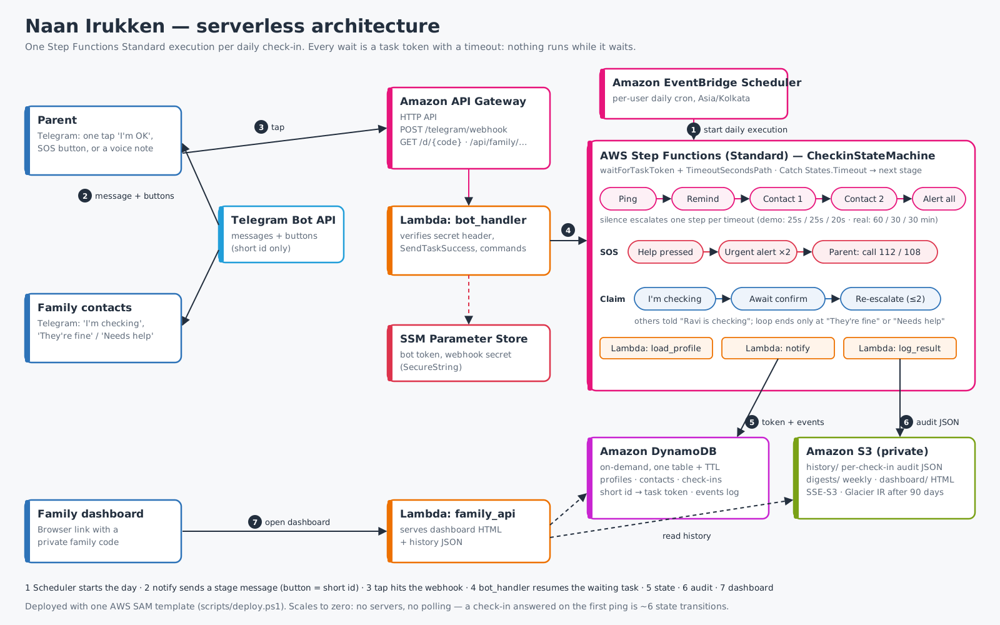
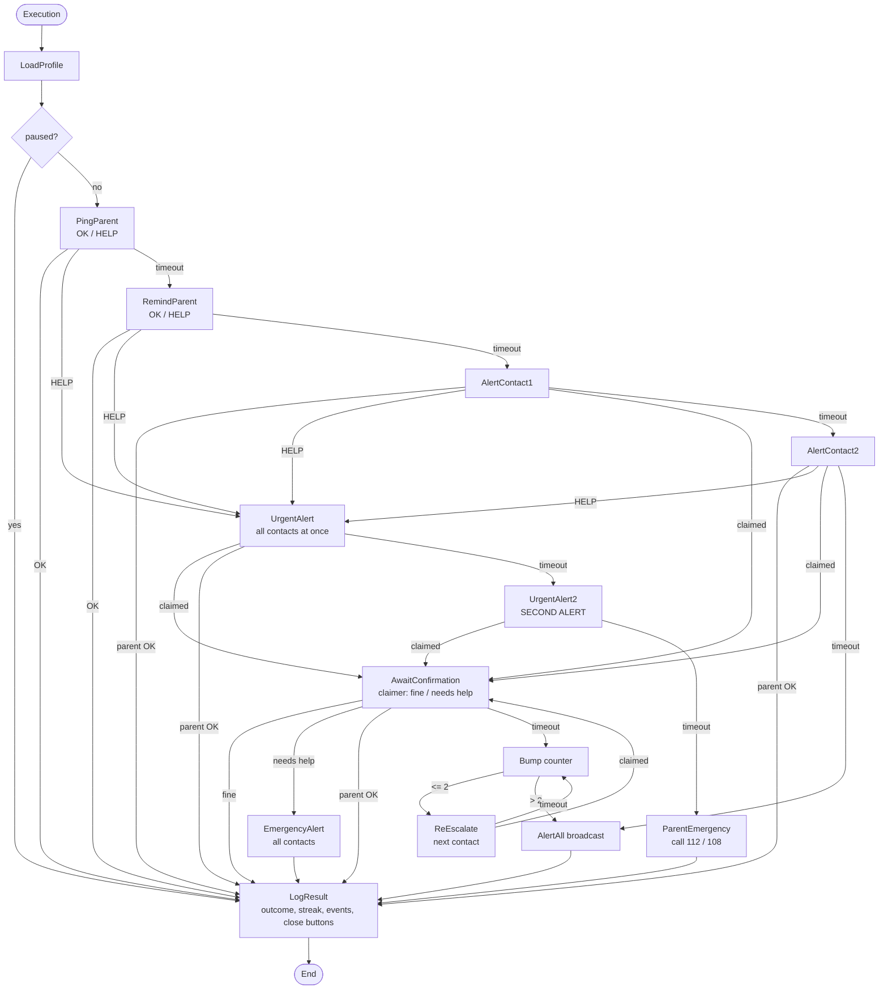

# Naan Irukken (நான் இருக்கேன் — "I'm here")

A one-tap daily check-in for elderly parents living alone, with automatic family escalation. Fully serverless.

## The problem
Many parents live alone while their children work in other cities. If a parent falls or falls ill at home, it can be hours before anyone notices.

Daily phone calls get missed, and nothing happens when a call goes unanswered. Nobody is *responsible* for noticing the silence.

Naan Irukken turns silence into a signal: one button a day, and a chain of escalation if it is not pressed.

## How it works
- **Escalation:** ping the parent → reminder → Contact 1 → Contact 2 → alert everyone.
- **Claim and confirm:** a contact taps "I'm checking" (the others are told). They then confirm "They're fine" or "Needs help". If nobody confirms, it re-escalates.
- **SOS:** the 🆘 button sends an urgent alert to all contacts, twice, then tells the parent to call 112/108.
- **Any message counts:** any text or voice note is a check-in (voice notes are forwarded to the family).

## Architecture




| Service | Role |
|---|---|
| Lambda | Telegram webhook, one function per workflow step, dashboard API, weekly digest |
| API Gateway (HTTP API) | Telegram webhook, family dashboard page and JSON |
| DynamoDB | Single table: profiles, contacts, check-ins, short-id → task-token map, dedupe markers |
| S3 | Private audit trail (`history/`, `digests/`) and the dashboard page |
| Step Functions (Standard) | One execution per daily check-in; every wait is a task token with a timeout |
| EventBridge Scheduler | One schedule per parent, in Asia/Kolkata, starting the daily execution |

## The task-token escalation pattern
Each waiting stage is a `lambda:invoke.waitForTaskToken` task. The Lambda sends the Telegram message and stores the task token in DynamoDB. Then the execution **pauses at no cost**.

- **Short id → token:** Telegram `callback_data` is limited to 64 bytes, so the buttons carry only `kind:shortId`. The long task token stays server-side and is never sent to the client.
- **Button tap:** the webhook looks up the short id and calls `SendTaskSuccess` with the answer (`ok`, `help`, `claimed`, ...). A Choice state then routes on it.
- **Timeout:** the task uses `TimeoutSecondsPath`. The timeouts come in the execution input, so demo and real runs share one definition. A `Catch` on `States.Timeout` moves to the next stage.
- **Stale buttons:** the final step closes any open buttons.

Reuse it for lone-worker safety (check in or alert the supervisor), medication reminders (confirm or notify a carer), and approvals (approve, or escalate to the next approver).

## Scale to zero
A check-in answered on the first ping costs about **6 state transitions**, roughly 180 a month. The Step Functions free tier (4,000 transitions/month, does not expire) therefore covers about **22 families**. Everything else (Lambda, DynamoDB, API Gateway, S3, Scheduler) is on-demand, so an idle deployment costs nothing. The dashboard's cost card shows the estimate for each family. Costs are estimates at AWS list prices; verify them in `src/shared/prices.py`.

## Security
- Private S3 bucket: block public access on, SSE-S3 encryption, history moves to Glacier IR after 90 days.
- The Telegram webhook is checked against a secret header; the bot token and webhook secret live in SSM Parameter Store SecureString.
- Least-privilege IAM for each function (table, bucket prefix and parameter ARNs are scoped).
- Two exceptions where AWS does not support resource scoping, so `Resource: "*"` is the tightest option: Step Functions log delivery (`logs:*Delivery`) and `states:SendTaskSuccess/Failure`.
- The dashboard link is a 24-character random code (a bearer secret): share it only with family.

## Deploy (Windows PowerShell)
Prerequisites: AWS CLI v2 (configured), SAM CLI, Python 3.12, and a bot created with @BotFather.

```powershell
scripts\put_secrets.ps1     # stores the bot token and webhook secret in SSM (prompts; nothing is echoed)
scripts\deploy.ps1          # sam validate --lint, build, deploy, then uploads the dashboard page
scripts\set_webhook.ps1     # points Telegram at the API Gateway URL
```

Edit `parameter_overrides` in `samconfig.toml`, or pass them to `sam deploy`:
- `BotUsername`: your bot's username without the @.
- `AdminTelegramId`: your Telegram user id, the only user allowed to run `/demo`.
- `DemoMode`: `true` makes `/demo` use 25s/25s/20s timeouts. Scheduled check-ins always use real timeouts.

## Bot commands
| Command | What it does |
|---|---|
| `/start` | Parent: register and get the daily check-in. `/start inv_<code>`: join as a family contact |
| `/invite` | Parent: create a one-use invite link (valid 7 days, up to 5 contacts) |
| `/contacts` | List family contacts |
| `/time HH:MM` | Set the daily check-in time (IST, default 08:00) |
| `/pause` · `/resume` | Pause or resume check-ins (for travel, hospital stays, ...) |
| `/status` | Today's state, streak and last seen |
| `/dashboard` | Link to the family dashboard (parent or contact) |
| `/demo` | Admin only: run a check-in now with short timeouts |

## Limitations and the production path
- Telegram is used for the demo. Production would use the **WhatsApp Business API**, which parents already use.
- SMS in India needs **DLT registration** (sender id and templates) before it can be used as a fallback.
- Put **CloudFront and a custom domain** in front of the dashboard (the API Gateway URL is fine for a demo).
- Message copy is in English only; add multi-language copy (Tamil, Hindi, ...).
- The routine insight is a routine-change signal only, never a health claim. It is not an emergency service.

## License
MIT, see [LICENSE](LICENSE).
