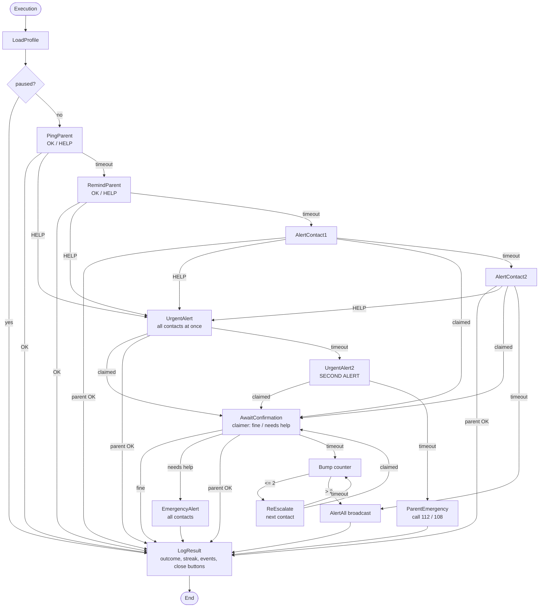

# Naan Irukken - architecture

One Step Functions execution per daily check-in. Every wait is `lambda:invoke.waitForTaskToken`:
the task token is stored in DynamoDB and Telegram buttons only carry a short id.

Outcomes: `resolved`, `confirmed_safe`, `needs_help`, `help_unclaimed`, `escalated`, `skipped`, `error`.

## Check-in item (DynamoDB `CHECKIN#<id>` / `META`)
`stage`, `activeShortId`, `activeToken`, `openMsgs`, `helpAt`, `claimedBy(Id)`, `confirmedBy`,
`reescalations`, `timeline` (final state output), and `events` - the append-only audit log
`{t, type, actor, role, via, stage}` that the Phase 4 S3 history and dashboard are built from.

## Callback data
`ok:` parent fine, `help:` parent SOS, `ack:` contact claims, `cf:` / `cn:` claimer's "fine" / "needs help".
